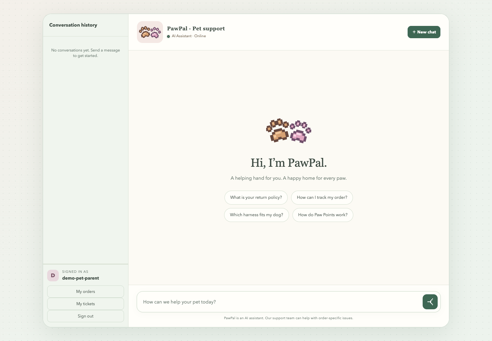

# CommerceAgent · Paw & Hearth

[](https://github.com/lllcr6/CommerceAgent/actions/workflows/ci.yml)

An English customer-support agent for e-commerce, demonstrated with Paw & Hearth, a fictional U.S. pet-supply retailer. It combines policy-grounded answers, authenticated order tools, confirmed support actions, human handoff, and an operations dashboard. The workflows can be adapted to other retailers by integrating their policies, catalog, and business systems.

[Watch the project demo](https://youtu.be/qCtvorLMRSI)



## Capabilities

- **Grounded answers:** English policy and product documents, dense and BM25 retrieval, reciprocal-rank fusion, reranking, numbered citations, and an evidence-confidence gate.
- **Controlled actions:** a LangGraph workflow verifies order ownership and requests explicit confirmation before creating tickets or refund requests. Logistics and after-sales tools run through internal MCP services.
- **Persistent conversations:** streamed responses continue when customers navigate away; stored generation snapshots restore output. Anchored history and append-only summaries manage context.
- **Human support:** customers can request an agent or submit an independent ticket. Support specialists claim work, post public updates or internal notes, and update authorized orders with optimistic concurrency checks.
- **Operations:** knowledge ingestion and review, resumable RAG and Agent evaluations, local token accounting, confidence calibration, and an English multi-label topic-classifier pipeline.

The storefront, orders, tracking events, and prices are simulated. The application does not execute payments, issue shipping labels, or connect to a production commerce platform.

## Architecture

FastAPI serves the API and static UI. LangGraph orchestrates intent routing, retrieval, tool execution, confirmation interrupts, and responses. MySQL is the source of truth for business records and knowledge text; Milvus provides dense and English BM25 search. Chat, embedding, and reranking providers are configured separately. Langfuse is optional for traces; local usage accounting works independently.

| Directory | Responsibility |
| --- | --- |
| `app/api/` | Authenticated HTTP and SSE endpoints |
| `app/graph/` | Agent state, nodes, routing, and checkpoint runtime |
| `app/core/` | Model clients, retrieval, context budgets, summaries, and quality gates |
| `app/kb/` | Document chunking, ingestion, indexing, deduplication, and review |
| `app/tools/` | Tool discovery, validation, authorization, confirmation, and audit |
| `app/db/` | SQLAlchemy models and repositories |
| `app/static/` | Customer, support, and administration interfaces |
| `mcp_servers/` | Internal logistics and after-sales services |
| `scripts/` | Operational commands, evaluations, and classifier training |
| `sql/` | Ordered schema initialization and sample data |
| `tests/` | Unit, API, workflow, integration, and frontend checks |
| `data/` | Knowledge, evaluation inputs, model artifacts, and reports |

See [architecture and operating boundaries](docs/architecture.md), [deployment](DEPLOY.md), and [data layout](data/README.md).

## Quick start

Requires Python 3.12+, uv, Docker Compose, and Make. Run commands from the repository root.

```bash
cp .env.example .env
# Set CHAT_*, EMBED_*, and RERANK_* for your model providers.
uv sync
docker compose up -d
make seed
make kb-build
make kb-vectorize
make dev
```

Open [the application](http://localhost:8000) and register a customer account. Each customer receives two independent USD sample orders: Self-Cleaning Litter Box Pro ($499) and Everyday Pet Fountain 2L ($39). These are fictional demonstration prices.

Create support and administrator accounts in another terminal; passwords are entered interactively:

```bash
uv run python -m scripts.create_account support1 --role support
uv run python -m scripts.create_account admin1 --role admin
```

Customers use `/`, support specialists use `/support`, and administrators use `/admin`. Use separate browser profiles to demonstrate different roles concurrently. `make dev` starts the application on port 8000 and MCP services on 8101/8102. Knowledge indexing is a separate first-run step; startup does not import documents automatically.

## Evaluation

Current inputs contain 121 English RAG questions and 12 English three-turn Agent scenarios. Reports identify the exact dataset, model configuration, run state, and sample count. Synthetic evaluation results describe these cases; they do not establish production resolution rates or staffing savings.

```bash
make rag-check-offline                 # Validate local relevance annotations
make eval-check                        # Validate against the live index
make eval-rag                          # New four-strategy RAG evaluation
make eval-rag CONTINUE=1               # Fill missing work in the latest run
make bench-agent                       # Authenticated SSE benchmark, three repeats
make bench-agent CONTINUE=1            # Continue the latest Agent run
make roberta-audit                     # Validate frozen English topic partitions
```

Model-backed evaluations consume provider credits. Continuation reuses successful work only when its required configuration and input identities match. Failed calls remain missing rather than becoming zero scores. Private benchmark account credentials are excluded from public reports.

The English topic dataset is synthetic and has its own [dataset card](data/roberta/DATASET_CARD.md). Train, evaluate, and export compatible English artifacts before enabling the optional classifier. Independently reviewed gold labels remain a separate validation requirement.

See [evaluation protocols](data/benchmarks/README.md) for metrics, limitations, and report locations.

## Testing

```bash
uv run pytest --offline  # No MySQL, Milvus, or live MCP processes
uv run pytest            # Full suite with integration services
node --test tests/frontend/*.cjs
```

GitHub Actions runs the offline suite, frontend checks, Python syntax checks, RAG
annotation validation, and the frozen topic-data audit on pushes and pull requests.
CI uses placeholder credentials and loopback provider endpoints, with no repository
secrets or model-backed evaluations. Heavy ML dependencies are excluded; model
training/export tests skip when their optional dependencies are unavailable.

Some integration tests require the configured MySQL test database; retrieval integration tests need Milvus. Provider smoke checks and model-backed evaluations require working credentials. Configure `TEST_DATABASE_URL` separately from the application database.

## Operational limits

The default development runner uses one application process. Background generation survives browser disconnects, but process restarts mark unfinished replies interrupted; writes are not automatically replayed. Multiple workers require shared task ownership and a worker queue. MySQL uses cross-process conversation locks; SQLite fixtures use in-process locks.

Customer, support, and administrator permissions are distinct. Customers access their own records; support agents access assigned work; administrators supervise and assign tickets without impersonating support agents. Tools share these ownership boundaries and audit decisions.
